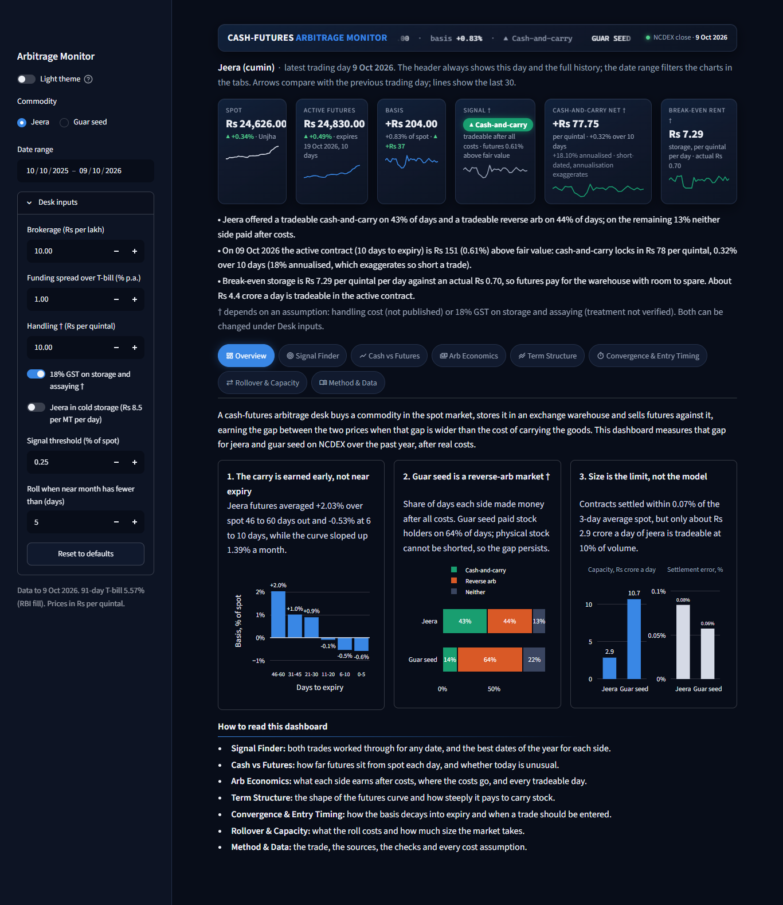
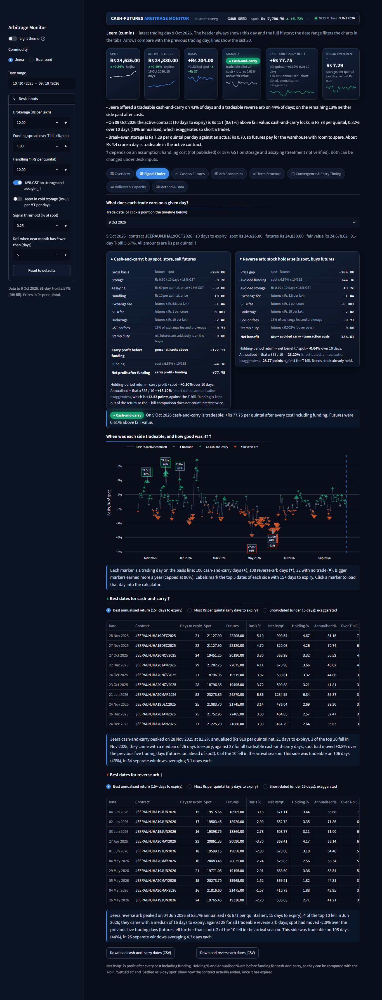
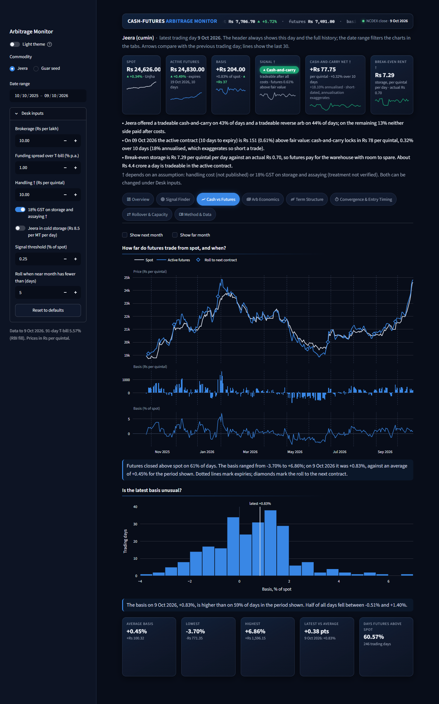
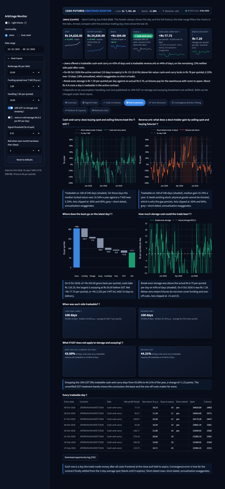
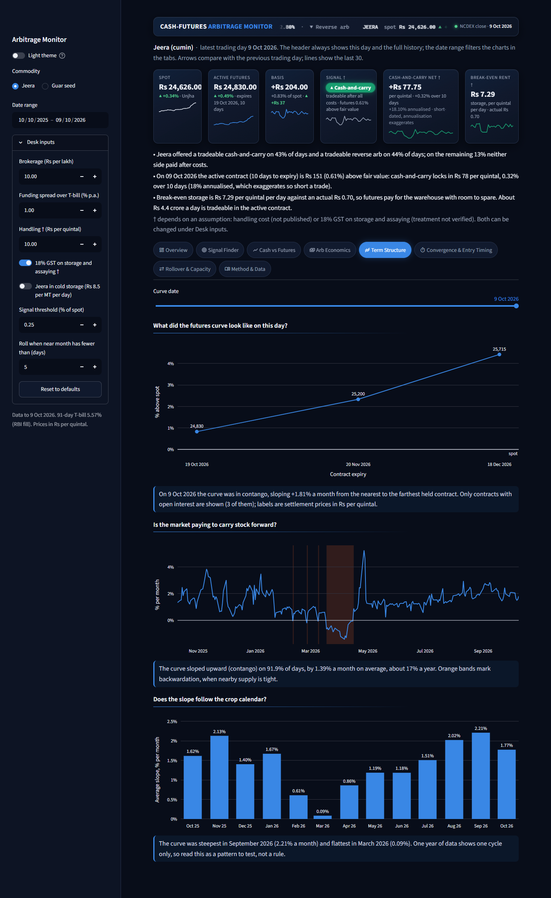
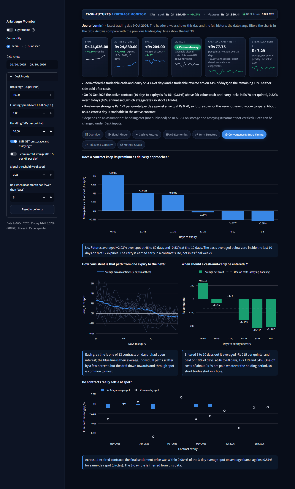
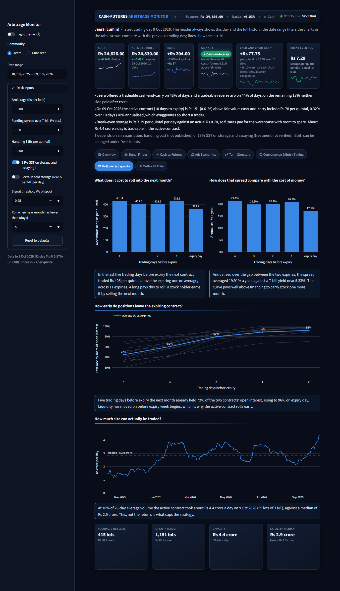
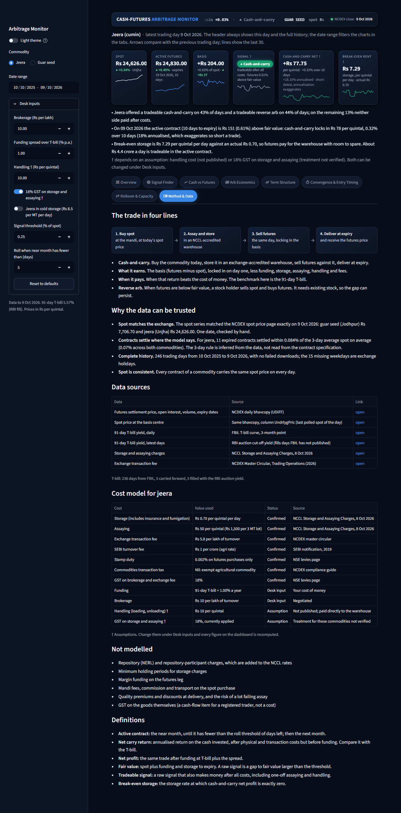

# Commodity Cash-Futures Arbitrage Monitor: Dashboard Guide

This guide explains every part of the dashboard: what each block shows, what it uses, how it is worked out, what it tells a trader, where it is weak, and a question an interviewer might ask about it.

All "current reading" examples are for **9 Oct 2026**, the latest trading day in the data, with the default desk inputs (brokerage Rs 10 per lakh, funding at T-bill + 1%, handling Rs 10 per quintal, 18% GST on storage and assaying). Figures marked † depend on the handling or GST assumption. After a data refresh the dashboard updates itself; this guide does not.

## 1. Purpose

### What the desk does

A cash-futures arbitrage desk trades the gap between the price of a commodity today (spot) and its price for delivery later (futures). It does not bet on the price going up or down. It locks in a price difference and earns it by holding or delivering the goods.

### The two commodities

| Commodity | Futures symbol | Lot size | Basis centre (where spot is measured) |
|---|---|---|---|
| Jeera (cumin) | JEERAUNJHA | 3 MT | Unjha, Gujarat |
| Guar seed | GUARSEED10 | 5 MT | Jodhpur, Rajasthan |

Both trade on NCDEX and both are **compulsory delivery** contracts: anyone still holding a position at expiry must give or take physical goods. That is what ties the futures price to the spot price and makes the arbitrage real.

### The two trades

- **Cash-and-carry.** Buy the commodity in the spot market, store it in an exchange-accredited warehouse, sell futures the same day, and deliver at expiry. The profit is futures minus spot, less the cost of carrying the goods (funding, storage, assaying, handling, fees). It works when futures are well above spot.
- **Reverse arb.** Someone who already holds stock sells it at spot and buys futures, taking delivery back at expiry. They pocket the price gap and save the funding and storage they would have paid. It works when futures are below fair value. It needs existing stock, because physical goods cannot be borrowed and sold short. That is why this gap can last for weeks.

The benchmark for both is the 91-day Treasury bill yield: the return available for taking no risk.

## 2. Data

### Sources

| Data | Source | What it provides | Frequency |
|---|---|---|---|
| Futures prices | NCDEX daily bhavcopy (UDiFF file) | Settlement price, open interest, volume and expiry date for every contract | Daily |
| Spot price | Same bhavcopy, column `UndrlygPric` | The last polled spot price of the day at the basis centre | Daily |
| Basis centre | Same download, legacy file | The delivery centre each contract is priced at | Daily |
| 91-day T-bill yield | FBIL T-bill curve, 3-month point | Daily risk-free rate | Daily, published about a week late |
| 91-day T-bill, latest days | RBI auction cut-off yield | Fills the days FBIL has not yet published | Weekly auction |
| Storage and assaying charges | NCCL "Storage and Assaying Charges", 8 Oct 2026 | Warehouse rent per MT per day; assaying charge per sample lot | One document |
| Exchange fee | NCDEX Master Circular, Trading Operations (2026) | Rs 5.8 per lakh of futures turnover | One document |
| SEBI fee, stamp duty, CTT, GST | SEBI notification (2019), NSE levies page, NCDEX compliance guide | The statutory charges | One document each |

### Coverage

- **Date range:** 10 Oct 2025 to 9 Oct 2026.
- **Trading days:** 246. The other 15 weekdays in the window are exchange holidays. No download failed.
- **Rows:** 2,689 contract-days (jeera 1,050 across 15 contracts; guar seed 1,639 across 19 contracts).
- **T-bill:** 236 days from FBIL, 5 carried forward across gaps, 5 filled with the RBI auction yield.

### How the data was validated

| Check | Result |
|---|---|
| Spot against the NCDEX spot price page | Exact match on 9 Oct 2026: guar seed (Jodhpur) Rs 7,706.70 and jeera (Unjha) Rs 24,626.00. One date, checked by hand. |
| Spot is the same on every contract of a commodity | True on all 492 commodity-days. |
| Contracts settle at spot | Across 23 expired contracts, the final settlement price was within 0.07% of the 3-day average spot on average. Against same-day spot the gap is 0.61%. |
| Outliers | No daily spot or near-month move above 8%; no zero or negative prices. |

The 3-day settlement rule (expiry day plus the two trading days before) is **inferred from the data**. It has not been read from the contract specification.

## 3. Glossary

| Term | Meaning |
|---|---|
| Spot | The price of the physical commodity today at the basis centre. |
| Futures | The price agreed today for delivery at a contract's expiry. |
| Basis | Futures minus spot. In Rs per quintal, or as a % of spot. |
| Contango | Later-dated futures cost more than nearer ones. The curve slopes up. |
| Backwardation | Later-dated futures cost less. The curve slopes down; nearby supply is tight. |
| DTE | Days to expiry: calendar days from today to the contract's expiry date. |
| Active contract | The contract the dashboard prices the trade on: the near month, until it has fewer than 5 days left. |
| Roll rule | When the near month has fewer than 5 days to expiry, the active contract becomes the next month. The threshold is a sidebar input. |
| Fair value | Spot plus funding and storage to expiry: what the future "should" cost. |
| Mispricing | Futures minus fair value. |
| Raw signal | Cash-and-carry if futures are more than 0.25% of spot above fair value; reverse if more than 0.25% below. |
| Tradeable signal | A raw signal that also makes money after every cost, including the one-off assaying and handling. This is the signal the dashboard shows. |
| Holding-period return | Profit divided by spot, over the days the trade is held. Not annualised. |
| Annualised return | Holding-period return x 365 / days to expiry. |
| Short-dated | Fewer than 15 days to expiry. Annualising exaggerates these, so the dashboard leads with rupees instead. |
| Break-even storage | The warehouse rent at which cash-and-carry would make exactly zero. |
| Calendar spread | Next-month futures minus near-month futures. |
| Roll % | The next month's share of the two contracts' combined open interest. |
| Capacity | 10% of the 20-day average daily volume: the size a desk could trade in a day. |

## 4. Sidebar and header

### Sidebar controls

| Control | Default | What it changes |
|---|---|---|
| Light theme | Off (dark) | Switches the whole dashboard to a light theme. On a shared deployment it changes the theme for every viewer. |
| Commodity | Jeera | Which commodity the header and every tab show. |
| Date range | Full year | Filters the charts and tables in the tabs. It does not change the header, which always shows the latest day. |
| Brokerage (Rs per lakh) | 10 | Cost on the futures leg of both trades. |
| Funding spread over T-bill (% a year) | 1.00 | The desk's cost of money above the T-bill. Raises funding cost and fair value. |
| Handling † (Rs per quintal) | 10 | One-off loading and unloading cost in cash-and-carry. An assumption. |
| 18% GST on storage and assaying † | On | Adds GST to warehouse rent and assaying. An assumption. |
| Jeera in cold storage | Off | Uses the cold-storage rent (Rs 8.5 per MT per day, against Rs 7). Jeera only. |
| Signal threshold (% of spot) | 0.25 | How far futures must be from fair value to raise a raw signal. |
| Roll when near month has fewer than (days) | 5 | The roll rule for the active contract. |
| Reset to defaults | | Puts every desk input back. |

Under the controls is a freshness line: the last trading date and the T-bill value with its source ("RBI fill" when FBIL has not yet published).

### Banner and ticker

- **What it shows:** the project name, a slowly scrolling strip with spot, active futures, basis % and signal for both commodities, and the date of the data.
- **Inputs:** the latest row of each commodity's daily table.
- **How calculated:** no calculation; the arrow beside spot is the change from the previous trading day.
- **What you can infer:** both markets at a glance. On 9 Oct 2026: jeera spot Rs 24,626.00, cash-and-carry signal; guar seed spot Rs 7,706.70 (up 5.72% on the day), reverse signal.
- **Caveats:** it looks live but is end-of-day data. The strip pauses when the mouse is over it.
- **Likely question:** "Is this real time?" No. It is the exchange's daily closing file. Live use would replace it with a quote feed.

### KPI cards

Each card has a small line showing the last 30 trading days and, where it makes sense, an arrow comparing with the previous day.

| Card | What it shows | How calculated | Reading on 9 Oct 2026 (jeera) |
|---|---|---|---|
| Spot | Spot price at the basis centre | `UndrlygPric` | Rs 24,626.00, up 0.34% |
| Active futures | Settlement price of the active contract, its expiry and DTE | Settlement price | Rs 24,830.00, expires 19 Oct 2026, 10 days |
| Basis | Futures minus spot, in Rs and % | futures - spot | +Rs 204.00, +0.83% |
| Signal † | The tradeable signal as a coloured pill | See glossary | Cash-and-carry; futures 0.61% above fair value |
| Trade card † | Net result of the tradeable side | Short-dated: Rs per quintal and holding-period return lead. Otherwise the annualised return leads. | +Rs 77.75 per quintal, +0.32% over 10 days (18.10% annualised, greyed) |
| Break-even rent † | Storage rate at which cash-and-carry makes zero | (gross - all other costs) / days | Rs 7.29 per quintal per day, against an actual Rs 0.70 |

- **What you can infer:** whether there is a trade today, on which side, how much it pays, and how much room there is before storage costs kill it.
- **Caveats:** the "active futures" arrow is hidden on a roll day, because yesterday's price belongs to a different contract. The break-even card reads "None" when futures do not even cover the other costs.
- **Likely question:** "Why does the card show rupees and not the annualised return?" The contract has 10 days left. Annualising multiplies a 0.32% gain by 36, which overstates what a desk can repeat.

### Insight sentences

- **What they show:** three sentences written from the data: how often each side was tradeable, what the latest day offers, and the break-even storage with tradeable size.
- **Inputs:** the full-year daily table and the liquidity table.
- **How calculated:** share of days per tradeable signal; the latest day's trade in words; the latest break-even and capacity.
- **Reading:** "Jeera offered a tradeable cash-and-carry on 43% of days and a tradeable reverse arb on 44% of days; on the remaining 13% neither side paid after costs."
- **Caveats:** rule-based text; it describes, it does not forecast.
- **Likely question:** "Are these hand-written?" No. They are generated by `build_insights` in `src/metrics.py` and change with the inputs.

## 5. The tabs

### 5.1 Overview



#### Opening sentence

- **What it shows:** one sentence on what a cash-futures desk does and what the dashboard measures.
- **Inputs, calculation:** none.
- **Likely question:** "Explain the strategy in one line." Buy spot, store, sell futures, deliver; earn the gap when it exceeds the cost of carry.

#### Finding 1: the carry is earned early, not near expiry

- **What it shows:** average basis % by days-to-expiry bucket, from 46-60 days out down to 0-5 days.
- **Inputs:** `basis_pct` and `days_to_expiry` for every contract on days it had open interest; full history.
- **How calculated:** group contract-days into six buckets and average the basis %.
- **What you can infer:** a contract loses its premium as delivery nears. Jeera: +2.03% at 46-60 days, -0.53% at 6-10 days, while the curve slopes up 1.39% a month. Enter cash-and-carry early.
- **Caveats:** an average across 11 to 13 contracts in one year; single contracts scatter by a few percent.
- **Likely question:** "Why would futures trade below spot just before delivery?" Sellers who do not want to deliver close out, the settlement uses a 3-day average that lags a moving spot, and delivered quality may be worth less than the polled spot grade.

#### Finding 2: guar seed is a reverse-arb market †

- **What it shows:** for each commodity, the share of days cash-and-carry was tradeable, reverse arb was tradeable, or neither.
- **Inputs:** `tradeable_signal` for every day; all desk inputs.
- **How calculated:** count days per signal and divide by 246.
- **What you can infer:** jeera 43% / 44% / 13%; guar seed 14% / 64% / 22%. Guar seed mostly pays people who already hold stock.
- **Caveats:** depends on the handling and GST assumptions, and on costs not modelled (mandi fees, transport), which would cut the cash-and-carry share further.
- **Likely question:** "Why does the reverse gap not close?" Closing it needs physical stock to sell. Stock cannot be borrowed, so only existing holders can do it, and only as far as they are willing to part with inventory.

#### Finding 3: size is the limit, not the model

- **What it shows:** two small panels: median tradeable capacity in Rs crore a day, and the average settlement error %, per commodity.
- **Inputs:** `volume` of the active contract; final settlement price and 3-day average spot of expired contracts.
- **How calculated:** capacity = 10% of 20-day average volume x price. Error = |final settlement / 3-day average spot - 1|.
- **What you can infer:** the model converges (jeera 0.08%, guar seed 0.06%), but only about Rs 2.9 crore a day of jeera and Rs 10.7 crore of guar seed can be traded.
- **Caveats:** 10% of volume is a rule of thumb. The two panels have different units and separate scales.
- **Likely question:** "So how much could we make?" Capacity x net return. In jeera, Rs 2.9 crore a day is about 44 lots; this is a small, steady trade, not a large one.

#### How to read this dashboard

One line per tab, to guide a first-time viewer.

### 5.2 Signal Finder



#### Return calculator

- **What it shows:** for a chosen date, both trades line by line in Rs per quintal, with the formula beside each amount, then holding-period return, annualised return and the gap to the T-bill. A line underneath says which side was tradeable.
- **Inputs:** spot, active futures, days to expiry and T-bill on that date; storage and assaying rates; every desk input.
- **How calculated:**
  - Cash-and-carry: gross = futures - spot. Subtract storage (rate x days), assaying, handling, exchange fee, SEBI fee, brokerage, GST on fees. That gives carry profit before funding. Holding-period return = carry profit / spot. Annualised = that x 365 / days. Then subtract funding (spot x (T-bill + spread) x days / 365) to get net profit.
  - Reverse arb: price gap = spot - futures. Add the funding and storage avoided. Subtract exchange fee, SEBI fee, brokerage, GST on fees and stamp duty. That gives net benefit.
- **What you can infer:** exactly where the money goes on any day. On 9 Oct 2026 jeera's Rs 204.00 basis leaves Rs 122.11 before funding and Rs 77.75 after.
- **Caveats:** closing prices; a real entry would be at intraday prices. Funding is kept out of the return (but inside net profit) so the T-bill comparison does not count interest twice.
- **Likely question:** "Why is stamp duty zero on cash-and-carry?" Stamp duty is charged to the buyer of a future. In cash-and-carry the futures are sold and then delivered against, so there is no purchase.

#### Signal timeline

- **What it shows:** one chart for the period. Each trading day is a marker on the basis line: teal up-triangle for cash-and-carry, orange down-triangle for reverse arb, grey square for no trade. Bigger markers earned more a year. The top 5 dates of each side are labelled with date and return. A dashed line marks the date in the calculator.
- **Inputs:** `basis_pct`, `tradeable_signal` and the annualised return of the tradeable side.
- **How calculated:** marker size scales with annualised return, capped at 90% so short-dated spikes do not dominate. Labels use only days with 15 or more days to expiry.
- **What you can infer:** signals come in clusters, not randomly. Jeera had 106 cash-and-carry days in 34 windows and 108 reverse days in 25 windows. Clicking a marker loads that day into the calculator.
- **Caveats:** marker size is capped; read exact returns from the tables.
- **Likely question:** "Are the best days isolated spikes?" No. They sit inside runs of several days, which is what makes them usable.

#### Best dates tables

- **What it shows:** for each side, the top 10 tradeable dates, with three rankings: best annualised return (15+ days to expiry, the main list), most Rs per quintal (any days to expiry), and short-dated (under 15 days, labelled as exaggerated).
- **Inputs:** every tradeable day; expiry settlements for the last two columns.
- **How calculated:** Net Rs/qtl is profit after every cost including funding. Holding % and Annualised % are before funding for cash-and-carry. "Over T-bill" is annualised minus the T-bill. "Settled at" and "Settled vs 3-day spot" show how the contract actually ended.
- **What you can infer (jeera):** best cash-and-carry was 28 Nov 2025: 81.16% annualised, Rs 909.54 per quintal, 21 days to expiry. Best reverse arb was 4 Jun 2026: 83.68% annualised, Rs 671.11 per quintal, 15 days.
- **Caveats:** these are the ten best days of a year, not a typical day. The median tradeable day earned about 16% (cash-and-carry) and 26% (reverse) annualised.
- **Likely question:** "Could you really have traded the best date?" In small size. Capacity on those days was a few crore, and the price is a daily close.

#### Narrative line

- **What it shows:** one generated paragraph per side: when returns peaked, what the top days had in common, and how often windows opened.
- **Inputs:** the top 10 list, the 5-day spot move before each date, days to expiry, and the crop's arrival months.
- **How calculated:** counts the month with most top-10 days; compares their median days to expiry with all tradeable days; takes the median 5-day spot move; counts runs of consecutive tradeable days.
- **Reading:** "Jeera cash-and-carry peaked on 28 Nov 2025 at 81.2% annualised. 3 of the top 10 fell in Nov 2025... tradeable on 106 days (43%), in 34 separate windows averaging 3.1 days each."
- **Caveats:** it describes what happened alongside the peaks; it does not prove cause. Arrival months are general market knowledge, not from a cited source.
- **Likely question:** "What drove the best cash-and-carry days?" Futures ran ahead of spot in a rising market in late 2025, about three to four weeks before expiry.

#### Downloads

Two buttons save all three rankings for each side as CSV.

### 5.3 Cash vs Futures



#### Spot, futures and basis chart

- **What it shows:** spot and the active futures on top; basis in Rs (bars) and basis in % (line) below, on one time axis. Dotted lines mark expiries; diamonds mark rolls. Two tick boxes add the next and far months.
- **Inputs:** `spot`, `settlement_price`, `basis`, `basis_pct`; the roll threshold; open interest for the optional lines.
- **How calculated:** basis = futures - spot; basis % = basis / spot x 100.
- **What you can infer:** futures closed above spot on 61% of days for jeera; the basis ranged from -3.70% to +6.86% and averaged +0.45%.
- **Caveats:** the futures line changes contract at each diamond, so a jump there is a roll, not a price move.
- **Likely question:** "Why three panels and not two axes on one chart?" Two y-axes on one chart invite misreading; separate panels keep each scale honest.

#### Basis distribution

- **What it shows:** a histogram of daily basis % with the latest value marked.
- **Inputs:** `basis_pct` for the period shown.
- **How calculated:** counts of days per basis bucket; percentile of the latest value.
- **What you can infer:** the latest jeera basis, +0.83%, is higher than on 59% of days. Half of all days fell between -0.51% and +1.40%. It is ordinary, not extreme.
- **Caveats:** mixes days with very different days to expiry; basis naturally shrinks near expiry.
- **Likely question:** "Is a 0.83% basis attractive?" On its own, no. It has to be compared with the cost of carry for the days left, which is what the next tab does.

#### Stat cards

Average, lowest, highest, latest against average, and the share of days futures were above spot.

### 5.4 Arb Economics



#### Cash-and-carry return against the T-bill †

- **What it shows:** annualised carry return over time against the 91-day T-bill (dashed). Shaded bands are tradeable days. Grey stretches are short-dated.
- **Inputs:** `cc_carry_return_pct`, `tbill_pct`, `tradeable_signal`; all cost inputs.
- **How calculated:** (gross - storage - assaying - handling - fees) / spot x 365 / days. Funding is not deducted here.
- **What you can infer:** jeera was tradeable on 106 of 246 days; on those days the median locked return was 16.34% a year against a T-bill near 5.33%.
- **Caveats:** the axis is clipped at -60% and +90%. Short-dated values are greyed because annualising exaggerates them.
- **Likely question:** "Why is the return quoted before funding?" So it can be compared with the T-bill without counting interest twice. Net profit, shown elsewhere, does deduct funding.

#### Reverse-arb return †

- **What it shows:** the same chart for a stock holder selling spot and buying futures.
- **Inputs:** `rev_return_pct`, `tradeable_signal`.
- **How calculated:** (spot - futures + avoided funding + avoided storage - transaction costs) / spot x 365 / days.
- **What you can infer:** jeera reverse arb was tradeable on 108 days with a median gain of 25.76% a year. Guar seed: 157 days.
- **Caveats:** only available to someone holding stock. The gain includes costs avoided, not just cash received.
- **Likely question:** "Why give reverse arb equal space?" In guar seed it is the dominant state of the market: 64% of days.

#### Cost waterfall †

- **What it shows:** the latest day's cash-and-carry per quintal: gross basis, then each cost, then net profit.
- **Inputs:** the latest day's row; all cost inputs.
- **How calculated:** each bar is one line of the cost model; storage and assaying are shown before GST, with all GST in its own bar.
- **What you can infer:** on 9 Oct 2026 jeera's +Rs 204.00 gross loses Rs 126.25 to costs. Assaying (Rs 50.00 before GST) is the largest, then funding (Rs 44.36). Net +Rs 77.75 per quintal, or +Rs 2,332 per 3 MT lot.
- **Caveats:** one day only. On a longer-dated trade funding and storage would be larger and assaying relatively smaller.
- **Likely question:** "What is the biggest cost?" For a short trade, the one-off assaying charge. For a long one, funding.

#### Break-even storage against actual storage †

- **What it shows:** the storage rate at which cash-and-carry would make zero, over time, against the actual NCCL rate.
- **Inputs:** `break_even_storage`, the NCCL storage rate.
- **How calculated:** (gross basis - all costs other than storage) / (days x GST multiplier).
- **What you can infer:** jeera's break-even was above the actual Rs 0.70 on 43% of days. On 9 Oct 2026 it was Rs 7.29: storage could be ten times dearer and the trade would still pay.
- **Caveats:** axis clipped at -15 and 25. Below zero means futures do not even cover funding and one-off costs.
- **Likely question:** "How sensitive is the trade to warehouse rent?" Hardly at all. Rent is Rs 0.70 a day on a Rs 24,600 commodity. The basis and the one-off costs decide the trade.

#### Side summary cards †

Days each side was tradeable, its share of days, the median annualised return and the average Rs per quintal. Jeera: cash-and-carry 106 days, average Rs 208.77; reverse arb 108 days, average Rs 278.23.

#### GST what-if †

- **What it shows:** two cards: the share of days each side was tradeable with and without 18% GST on storage and assaying.
- **Inputs:** the same year re-run with the GST switch on and off.
- **How calculated:** runs the cost model twice.
- **What you can infer:** jeera cash-and-carry days move from 43.09% to 44.31%; guar seed from 14.23% to 14.63%. The unverified GST treatment does not change the conclusion.
- **Caveats:** covers only this one assumption.
- **Likely question:** "What if your GST assumption is wrong?" It moves the answer by about one percentage point.

#### Opportunity log †

- **What it shows:** every tradeable day: date, contract, side, net profit, net return, days to expiry, prices, and how the contract finally settled. Sortable, with a CSV download.
- **Inputs:** the daily table and expiry settlements.
- **How calculated:** one row per day with a tradeable signal; the first four columns stay pinned.
- **What you can infer:** the full list behind every count on this tab.
- **Caveats:** assumes entry at the close and holding to expiry.
- **Likely question:** "How many trades is that?" Not 106 trades. Days cluster into windows; a desk would enter once per window, in size limited by capacity.

### 5.5 Term Structure



#### Futures curve on a chosen date

- **What it shows:** each contract with open interest, plotted by expiry, as % above spot. A slider picks the date.
- **Inputs:** `settlement_price`, `spot`, `open_interest` (contracts with none are left out).
- **How calculated:** (futures / spot - 1) x 100 for each contract.
- **What you can infer:** on 9 Oct 2026 jeera had three held contracts (Rs 24,830, 25,200 and 25,715), rising 1.81% a month: contango.
- **Caveats:** far contracts trade thinly; contracts with no open interest carry theoretical prices and are excluded.
- **Likely question:** "Why drop contracts with no open interest?" Their settlement price is computed by the exchange, not traded, so it says nothing about what the market will pay.

#### Curve slope over time

- **What it shows:** the slope of the curve in % per month; orange bands mark backwardation.
- **Inputs:** nearest and farthest held contract each day.
- **How calculated:** (far / near - 1) x 100 / months between their expiries.
- **What you can infer:** jeera was in contango on 91.9% of days, averaging 1.39% a month (about 17% a year). Guar seed: 99.6% and 1.47%. The market pays well above financing to carry stock forward.
- **Caveats:** uses two points on the curve; a kinked curve would be summarised poorly.
- **Likely question:** "If the curve pays 17% a year, why is cash-and-carry not always profitable?" Because the near contract trades at or below spot. The premium sits between contracts, not between spot and the near month.

#### Monthly average slope

- **What it shows:** the average slope by calendar month.
- **Inputs:** the daily slope.
- **How calculated:** mean of the daily slope within each month.
- **What you can infer:** jeera's curve was steepest in September 2026 (2.21% a month) and flattest in March 2026 (0.09%), when the new crop arrives.
- **Caveats:** one year is one crop cycle. This is a pattern to test, not a rule.
- **Likely question:** "Is that seasonality?" It is consistent with harvest arrivals flattening the curve, but one cycle cannot prove it.

### 5.6 Convergence & Entry Timing



#### Basis by days to expiry

The same chart as Finding 1 on the Overview, for the selected date range. Its takeaway adds how many expiries had a negative average basis in their last 10 days: 8 of 12 for jeera.

#### Per-contract convergence paths

- **What it shows:** each contract's basis % over its last 60 days as a thin line, with the average in bold.
- **Inputs:** `basis_pct` and `days_to_expiry` per contract, on days with open interest.
- **How calculated:** the bold line is the mean across contracts by days to expiry, smoothed over 5 days.
- **What you can infer:** paths differ by a few percent, but most drift down towards and through spot.
- **Caveats:** 13 contracts; the average hides the spread.
- **Likely question:** "How reliable is the decay?" It is the common pattern, not a certainty. Individual expiries have stayed above spot to the end.

#### Entry timing †

- **What it shows:** average cash-and-carry net profit per quintal by how many days before expiry the trade was entered, with the one-off costs as a dashed line.
- **Inputs:** every held contract on every day (not just the active one); all cost inputs.
- **How calculated:** runs the cost model for every contract-day with 1 to 60 days to expiry, then averages by bucket.
- **What you can infer:** jeera entered 46-60 days out averaged +Rs 119 and paid on 64% of days; entered 6-10 days out it averaged -Rs 215 and paid on 18%. One-off costs of about Rs 69 are paid whatever the holding period.
- **Caveats:** averages over one year; assumes any contract with open interest could be traded at the close.
- **Likely question:** "When would you put the trade on?" Thirty to sixty days before expiry, when the premium is still there and the fixed costs are spread over a longer hold.

#### Convergence error at expiry

- **What it shows:** for each expired contract, the gap between final settlement and the 3-day average spot (bars) and same-day spot (circles).
- **Inputs:** settlement price on expiry day; spot on that day and the two before.
- **How calculated:** final settlement / reference spot - 1.
- **What you can infer:** jeera contracts settled within 0.084% of the 3-day average, against 0.57% for same-day spot. The spot series is the right one and the 3-day rule fits.
- **Caveats:** the rule is inferred, not read from the specification.
- **Likely question:** "What risk is left if you hold to expiry?" Price risk is close to nil. What remains is quality, delivery logistics and the 3-day averaging window.

### 5.7 Rollover & Capacity



#### Calendar spread in rupees

- **What it shows:** next-month minus near-month futures on each of the last five trading days before expiry, averaged across expiries.
- **Inputs:** settlement prices of the near and next contracts.
- **How calculated:** next - near, grouped by trading days left.
- **What you can infer:** jeera's next month traded Rs 406 per quintal above the expiring one on average. A long pays this to roll; a stock holder earns it by selling the next month.
- **Caveats:** 11 expiries; daily closes.
- **Likely question:** "What does rolling cost?" About Rs 406 per quintal in jeera and Rs 88 in guar seed.

#### Calendar spread annualised

- **What it shows:** the same spread as a % a year.
- **How calculated:** spread / near price x 365 / days between the two expiries.
- **What you can infer:** jeera 19.9% a year, guar seed 18.9%, against a T-bill near 5.3%. The curve pays far more than financing for one more month of carry.
- **Caveats:** the spread is not a risk-free return by itself; it needs stock and delivery.
- **Likely question:** "Is that a better trade than spot versus near month?" The data says yes: hold stock and sell the next month. It is the natural next strategy to add.

#### Roll %

- **What it shows:** the next month's share of the two contracts' open interest through expiry week; thin lines per expiry, average in bold.
- **Inputs:** open interest of the near and next contracts.
- **How calculated:** next OI / (near OI + next OI) x 100.
- **What you can infer:** five trading days before expiry the next month already held 72% of jeera's open interest, rising to 96% on expiry day (guar seed 87% to 100%). Liquidity leaves before expiry week.
- **Caveats:** open interest, not volume.
- **Likely question:** "Why roll the active contract five days early?" Because the market already has.

#### Capacity

- **What it shows:** deployable Rs crore per day over time, with the median as a dashed line; four cards underneath (volume, open interest, capacity, median capacity).
- **Inputs:** `volume` and `settlement_price` of the active contract; lot size.
- **How calculated:** 10% x 20-day average volume in MT, in whole lots, x price.
- **What you can infer:** jeera took about Rs 4.4 crore a day on 9 Oct 2026 (59 lots of 3 MT) against a median of Rs 2.9 crore. Guar seed: Rs 18.2 crore against Rs 10.7 crore.
- **Caveats:** a rule of thumb for futures only; the spot market's depth is not measured.
- **Likely question:** "What caps the strategy?" Liquidity, not return.

### 5.8 Method & Data



| Block | What it shows |
|---|---|
| The trade in four lines | Four boxes (buy spot, assay and store, sell futures, deliver) and four bullets on what the trade earns and when. |
| Why the data can be trusted | The validation evidence from section 2 of this guide. |
| Data sources | Each source with a link, and how many T-bill days came from each source. |
| Cost model | Every cost with the value used and its status: Confirmed, Desk input or Assumption. It updates with the sidebar. |
| Not modelled | The costs left out (see section 7). |
| Definitions | Short definitions of the terms used on the dashboard. |

- **Likely question:** "Which inputs are you unsure of?" Two: handling cost and GST on warehouse charges. Both are marked † everywhere they matter.

## 6. Worked examples

Both use jeera with default inputs. Amounts are Rs per quintal.

### Cash-and-carry on 28 Nov 2025 (the best date in the Signal Finder)

Contract JEERAUNJHA19DEC2025, 21 days to expiry. Spot 21,127.90. Futures 22,205.00. T-bill 5.34%, so funding is at 6.34%.

| Line | How | Amount |
|---|---|---|
| Gross basis | 22,205.00 - 21,127.90 | +1,077.10 |
| Storage | 0.70 x 21 days, plus 18% GST | -17.35 |
| Assaying | 50, plus 18% GST | -59.00 |
| Handling | 10, once | -10.00 |
| Exchange fee | 22,205 x 5.8 / 1,00,000 | -1.29 |
| SEBI fee | 22,205 x 1 / 1,00,00,000 | -0.002 |
| Brokerage | 22,205 x 10 / 1,00,000 | -2.22 |
| GST on fees | 18% of (1.29 + 2.22) | -0.63 |
| Stamp duty | Nil: futures are sold | 0.00 |
| **Carry profit before funding** | | **+986.61** |
| Funding | 21,127.90 x 6.34% x 21 / 365 | -77.07 |
| **Net profit** | | **+909.54** |

- Holding-period return = 986.61 / 21,127.90 = **4.67%** over 21 days.
- Annualised = 4.67% x 365 / 21 = **81.16%**, which is 75.82 points above the T-bill.
- Per 3 MT lot (30 quintals): about Rs 27,286 net.
- What happened: the contract settled at 20,930.85 on 19 Dec 2025, within 0.07% of the 3-day average spot. Spot had fallen, but the trade had locked its price on day one, so the profit was unaffected.

### Reverse arb on 4 Jun 2026

Contract JEERAUNJHA19JUN2026, 15 days to expiry. Spot 19,515.65. Futures 18,905.00. T-bill 5.48%, so funding is at 6.48%.

| Line | How | Amount |
|---|---|---|
| Price gap | 19,515.65 - 18,905.00 | +610.65 |
| Avoided funding | 19,515.65 x 6.48% x 15 / 365 | +51.97 |
| Avoided storage | 0.70 x 15 days, plus 18% GST | +12.39 |
| Exchange fee | 18,905 x 5.8 / 1,00,000 | -1.10 |
| SEBI fee | 18,905 x 1 / 1,00,00,000 | -0.002 |
| Brokerage | 18,905 x 10 / 1,00,000 | -1.89 |
| GST on fees | 18% of (1.10 + 1.89) | -0.54 |
| Stamp duty | 18,905 x 0.002% (buyer pays) | -0.38 |
| **Net benefit** | | **+671.11** |

- Holding-period return = 671.11 / 19,515.65 = **3.44%** over 15 days.
- Annualised = 3.44% x 365 / 15 = **83.68%**.
- Cash-and-carry on the same day would have lost Rs 747.54 per quintal.
- What it needs: the trader must already own the jeera. They sell it, hold cash for 15 days, and take the same quantity back through the futures contract.

## 7. Assumptions and what is not modelled

### Assumptions

| Assumption | Value used | How a different value changes the results |
|---|---|---|
| Handling cost | Rs 10 per quintal | At Rs 25, jeera's tradeable cash-and-carry days fall from about 43% to 40%. At Rs 0 they rise to about 44%. |
| GST on storage and assaying | 18% applied | Without it, jeera moves from 43.09% to 44.31% and guar seed from 14.23% to 14.63%. |
| Brokerage | Rs 10 per lakh | About Rs 2.50 per quintal on jeera; a small effect either way. |
| Funding spread | 1% over T-bill | Higher funding raises fair value: fewer cash-and-carry days, more reverse days. |
| Signal threshold | 0.25% of spot | Higher means fewer raw signals; the tradeable test still applies. |
| Roll rule | 5 days | A larger number moves to the next contract earlier. |
| SEBI fee | Rs 1 per crore (2019 notification) | Too small to matter; the current schedule has not been re-read. |
| 3-day settlement rule | Inferred from data | If wrong, convergence would be measured against the wrong level. The fit (0.07%) says it is right. |

### Not modelled

| Item | Direction of the effect |
|---|---|
| Repository and repository-participant charges | Small extra cost; lowers cash-and-carry returns slightly. |
| Minimum holding period for storage | Raises the cost of very short trades, which already lose money. |
| Margin funding on the futures leg | Ties up capital; lowers return on total capital for both sides. |
| Mandi fees, commission, transport | Probably the largest omission; would remove many marginal cash-and-carry days. |
| Quality premiums, discounts and failed assays | A tail risk, not an average cost. |
| Actual purchase price against polled spot | A desk buys at its own price, not the reference price. |
| GST on the goods | A cash-flow item for a registered trader, not a cost. |
| Guar seed assaying for a single lot | A 5 MT lot pays the full 10 MT sample charge: Rs 30 per quintal, not the Rs 15 used. |

Every omission hurts cash-and-carry and most leave reverse arb unchanged, so the true picture is somewhat more reverse-heavy than shown.

## 8. Running, refreshing and extending

### Run locally

```
python -m venv .venv
.venv\Scripts\Activate.ps1
pip install -r requirements.txt
streamlit run app/app.py
```

### Refresh the data

```
pip install -r requirements-dev.txt
python -m src.pipeline --update
python -m src.build_metrics
python -m pytest
git add -A
git commit -m "Refresh data"
git push
```

Run it in the evening, once NCDEX has published the day's bhavcopy. A hosted app redeploys on its own after the push. Check the date in the banner afterwards.

### Add another commodity

1. Add an entry to `config/commodities.toml`: futures symbol, lot size, basis centre.
2. Add its storage and assaying rates to `config/carry_costs.toml`.
3. Run `python -m src.pipeline` (the bhavcopy files already contain every NCDEX contract, so nothing new is downloaded) and `python -m src.build_metrics`.
4. Add it to the commodity list in `app/sidebar.py`.
5. Check three things before trusting it: the underlying price is the delivery-centre spot, contracts converge to it at expiry, and whether the commodity is exempt from CTT.

### Where things live

| Folder | Contents |
|---|---|
| `app/` | The dashboard: one module per tab in `app/tabs/` |
| `src/` | Data pipeline and the metrics engine (`src/metrics.py`) |
| `config/` | Commodities, published charges with sources, desk inputs and rules |
| `tests/` | Unit tests, app tests over date ranges, browser check, screenshots |
| `data/processed/` | The cleaned tables the dashboard reads |
| `reports/` | Phase reports, interview notes, screenshots |
| `docs/` | This guide |
