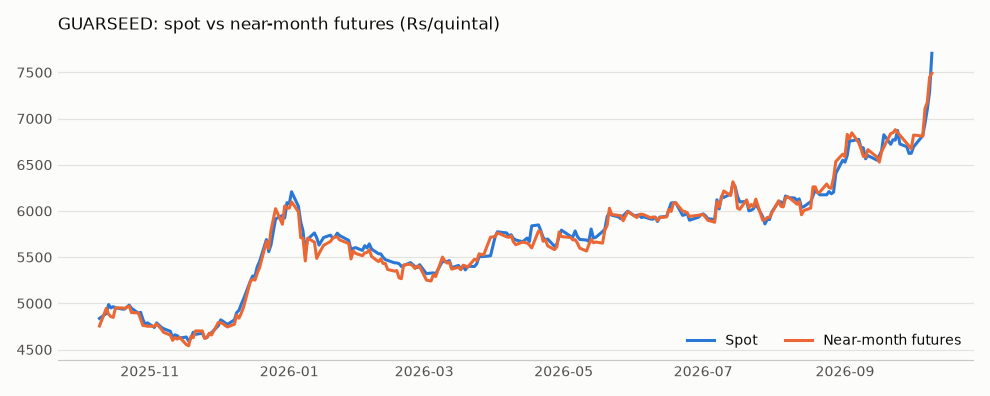
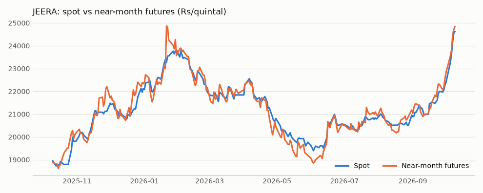

# Phase 2: data quality report

Generated by `python -m src.pipeline` on 2026-10-10. Prices in Rs/quintal; volume and open interest in MT.

## 1. Coverage

- Window: 2025-10-10 to 2026-10-10
- Weekdays in the window (expected at most): 261
- Trading days fetched: 246
- Weekdays where NCDEX published no file (exchange holidays): 15: 2025-10-22, 2025-11-05, 2025-12-25, 2026-01-15, 2026-01-26, 2026-03-03, 2026-03-26, 2026-03-31, 2026-04-03, 2026-04-14, 2026-05-01, 2026-05-28, 2026-06-26, 2026-09-14, 2026-10-02
- Weekdays not fetched for any other reason: 0: none
- Weekends are not requested. A special weekend session, if one happened, would be missed.

## 2. Row counts

- `futures.parquet`: 2689 rows; `spot.parquet`: 492 rows; `tbill.parquet`: 246 rows

| commodity | rows | trading_days | contracts | first_date | last_date | zero_oi_rows |
|---|---|---|---|---|---|---|
| GUARSEED | 1639 | 246 | 19 | 2025-10-10 | 2026-10-09 | 895 |
| JEERA | 1050 | 246 | 15 | 2025-10-10 | 2026-10-09 | 353 |

Per contract (`days_with_oi` = days the contract had open interest):

| commodity | contract_symbol | expiry | rows | first_date | last_date | days_with_oi | peak_oi_mt |
|---|---|---|---|---|---|---|---|
| GUARSEED | GUARSEED1020OCT2025 | 2025-10-17 | 6 | 2025-10-10 | 2025-10-17 | 6 | 12725 |
| GUARSEED | GUARSEED1020NOV2025 | 2025-11-20 | 28 | 2025-10-10 | 2025-11-20 | 28 | 51990 |
| GUARSEED | GUARSEED1019DEC2025 | 2025-12-19 | 49 | 2025-10-10 | 2025-12-19 | 49 | 57260 |
| GUARSEED | GUARSEED1020JAN2026 | 2026-01-20 | 69 | 2025-10-10 | 2026-01-20 | 57 | 63485 |
| GUARSEED | GUARSEED1020FEB2026 | 2026-02-20 | 91 | 2025-10-10 | 2026-02-20 | 61 | 64990 |
| GUARSEED | GUARSEED1020MAR2026 | 2026-03-20 | 110 | 2025-10-10 | 2026-03-20 | 59 | 64815 |
| GUARSEED | GUARSEED1020APR2026 | 2026-04-20 | 127 | 2025-10-10 | 2026-04-20 | 68 | 53330 |
| GUARSEED | GUARSEED1020MAY2026 | 2026-05-20 | 133 | 2025-11-03 | 2026-05-20 | 60 | 65195 |
| GUARSEED | GUARSEED1019JUN2026 | 2026-06-19 | 135 | 2025-12-01 | 2026-06-19 | 54 | 61715 |
| GUARSEED | GUARSEED1020JUL2026 | 2026-07-20 | 133 | 2026-01-01 | 2026-07-20 | 62 | 64885 |
| GUARSEED | GUARSEED1020AUG2026 | 2026-08-20 | 136 | 2026-02-02 | 2026-08-20 | 65 | 57870 |
| GUARSEED | GUARSEED1018SEP2026 | 2026-09-18 | 136 | 2026-03-02 | 2026-09-18 | 62 | 51870 |
| GUARSEED | GUARSEED1016OCT2026 | 2026-10-16 | 131 | 2026-04-01 | 2026-10-09 | 53 | 68680 |
| GUARSEED | GUARSEED1020NOV2026 | 2026-11-20 | 111 | 2026-05-04 | 2026-10-09 | 34 | 79540 |
| GUARSEED | GUARSEED1018DEC2026 | 2026-12-18 | 92 | 2026-06-01 | 2026-10-09 | 18 | 4190 |
| GUARSEED | GUARSEED1020JAN2027 | 2027-01-20 | 71 | 2026-07-01 | 2026-10-09 | 8 | 35 |
| GUARSEED | GUARSEED1019FEB2027 | 2027-02-19 | 48 | 2026-08-03 | 2026-10-09 | 0 | 0 |
| GUARSEED | GUARSEED1019MAR2027 | 2027-03-19 | 27 | 2026-09-01 | 2026-10-09 | 0 | 0 |
| GUARSEED | GUARSEED1020APR2027 | 2027-04-20 | 6 | 2026-10-01 | 2026-10-09 | 0 | 0 |
| JEERA | JEERAUNJHA20OCT2025 | 2025-10-17 | 6 | 2025-10-10 | 2025-10-17 | 6 | 1995 |
| JEERA | JEERAUNJHA20NOV2025 | 2025-11-20 | 28 | 2025-10-10 | 2025-11-20 | 26 | 3582 |
| JEERA | JEERAUNJHA19DEC2025 | 2025-12-19 | 49 | 2025-10-10 | 2025-12-19 | 43 | 3495 |
| JEERA | JEERAUNJHA20JAN2026 | 2026-01-20 | 69 | 2025-10-10 | 2026-01-20 | 59 | 4461 |
| JEERA | JEERAUNJHA20MAR2026 | 2026-03-20 | 95 | 2025-11-03 | 2026-03-20 | 95 | 5841 |
| JEERA | JEERAUNJHA20APR2026 | 2026-04-20 | 93 | 2025-12-01 | 2026-04-20 | 78 | 7020 |
| JEERA | JEERAUNJHA20MAY2026 | 2026-05-20 | 92 | 2026-01-01 | 2026-05-20 | 67 | 9888 |
| JEERA | JEERAUNJHA19JUN2026 | 2026-06-19 | 93 | 2026-02-02 | 2026-06-19 | 46 | 10986 |
| JEERA | JEERAUNJHA20JUL2026 | 2026-07-20 | 93 | 2026-03-02 | 2026-07-20 | 83 | 9843 |
| JEERA | JEERAUNJHA20AUG2026 | 2026-08-20 | 97 | 2026-04-01 | 2026-08-20 | 61 | 10239 |
| JEERA | JEERAUNJHA18SEP2026 | 2026-09-18 | 97 | 2026-05-04 | 2026-09-18 | 59 | 9516 |
| JEERA | JEERAUNJHA19OCT2026 | 2026-10-19 | 92 | 2026-06-01 | 2026-10-09 | 42 | 7749 |
| JEERA | JEERAUNJHA20NOV2026 | 2026-11-20 | 71 | 2026-07-01 | 2026-10-09 | 21 | 8346 |
| JEERA | JEERAUNJHA18DEC2026 | 2026-12-18 | 48 | 2026-08-03 | 2026-10-09 | 11 | 312 |
| JEERA | JEERAUNJHA20JAN2027 | 2027-01-20 | 27 | 2026-09-01 | 2026-10-09 | 0 | 0 |

T-bill yield by source (range 5.15% to 5.57%):

| source | days |
|---|---|
| fbil | 236 |
| ffill | 5 |
| rbi_fill | 5 |

## 3. Spot consistency

**Passed.** `UndrlygPric` is identical across all contracts of a commodity on all 492 date x commodity pairs.

Manual cross-check against the NCDEX spot price page for 9 Oct 2026: guar seed Jodhpur 7,706.70 (16:50) and jeera Unjha 24,626.00 (15:19), both identical to the bhavcopy. `UndrlygPric` is the last polled spot of the day.

## 4. Expiry convergence

For every contract that expired inside the window: its final settlement price against the spot price on expiry day, and against the average spot of the last three trading days (expiry day and the two before).

- Contracts checked: 23; all have a row on their expiry day: True
- Gap to same-day spot: mean 0.614%, largest 1.952%
- Gap to 3-day average spot: mean 0.070%, largest 0.267%

**Reading.** The final settlement price tracks the 3-day average of `UndrlygPric` far more closely than the same-day value, often to the paisa. That pattern says the exchange settles contracts on a 3-day average of this same spot series, which confirms `UndrlygPric` is the delivery-centre spot. The gaps to same-day spot are the averaging effect when spot is moving, not a data problem. (The 3-day rule is inferred from the data; the contract specification should be read to confirm it.)

| commodity | contract_symbol | expiry | on_expiry_day | settlement_price | spot | gap_vs_spot_pct | spot_3day_avg | gap_vs_3day_avg_pct |
|---|---|---|---|---|---|---|---|---|
| GUARSEED | GUARSEED1020OCT2025 | 2025-10-17 | True | 4951.1 | 4952.2 | -0.022 | 4955.75 | -0.094 |
| GUARSEED | GUARSEED1020NOV2025 | 2025-11-20 | True | 4628.75 | 4687.35 | -1.25 | 4632.33 | -0.077 |
| GUARSEED | GUARSEED1019DEC2025 | 2025-12-19 | True | 5386.05 | 5452.1 | -1.211 | 5381.28 | 0.089 |
| GUARSEED | GUARSEED1020JAN2026 | 2026-01-20 | True | 5704.05 | 5706.55 | -0.044 | 5719.05 | -0.262 |
| GUARSEED | GUARSEED1020FEB2026 | 2026-02-20 | True | 5415.3 | 5408.85 | 0.119 | 5412.95 | 0.043 |
| GUARSEED | GUARSEED1020MAR2026 | 2026-03-20 | True | 5390.5 | 5401.3 | -0.2 | 5389.22 | 0.024 |
| GUARSEED | GUARSEED1020APR2026 | 2026-04-20 | True | 5783.6 | 5849.1 | -1.12 | 5785.78 | -0.038 |
| GUARSEED | GUARSEED1020MAY2026 | 2026-05-20 | True | 5843.75 | 5939.75 | -1.616 | 5840.12 | 0.062 |
| GUARSEED | GUARSEED1019JUN2026 | 2026-06-19 | True | 6088.05 | 6087.7 | 0.006 | 6088.05 | 0.0 |
| GUARSEED | GUARSEED1020JUL2026 | 2026-07-20 | True | 6120.35 | 6103.1 | 0.283 | 6120.33 | 0.0 |
| GUARSEED | GUARSEED1020AUG2026 | 2026-08-20 | True | 6196.5 | 6200.0 | -0.056 | 6196.52 | -0.0 |
| GUARSEED | GUARSEED1018SEP2026 | 2026-09-18 | True | 6691.65 | 6824.9 | -1.952 | 6691.63 | 0.0 |
| JEERA | JEERAUNJHA20OCT2025 | 2025-10-17 | True | 18775.6 | 18924.8 | -0.788 | 18818.42 | -0.228 |
| JEERA | JEERAUNJHA20NOV2025 | 2025-11-20 | True | 21062.75 | 21066.45 | -0.018 | 21053.9 | 0.042 |
| JEERA | JEERAUNJHA19DEC2025 | 2025-12-19 | True | 20930.85 | 20913.4 | 0.083 | 20945.58 | -0.07 |
| JEERA | JEERAUNJHA20JAN2026 | 2026-01-20 | True | 23000.8 | 23393.7 | -1.68 | 23062.37 | -0.267 |
| JEERA | JEERAUNJHA20MAR2026 | 2026-03-20 | True | 22151.5 | 22078.15 | 0.332 | 22152.9 | -0.006 |
| JEERA | JEERAUNJHA20APR2026 | 2026-04-20 | True | 21605.6 | 21773.15 | -0.77 | 21643.05 | -0.173 |
| JEERA | JEERAUNJHA20MAY2026 | 2026-05-20 | True | 19790.0 | 19915.3 | -0.629 | 19818.28 | -0.143 |
| JEERA | JEERAUNJHA19JUN2026 | 2026-06-19 | True | 20602.05 | 20674.25 | -0.349 | 20602.07 | -0.0 |
| JEERA | JEERAUNJHA20JUL2026 | 2026-07-20 | True | 20637.0 | 20895.9 | -1.239 | 20637.02 | -0.0 |
| JEERA | JEERAUNJHA20AUG2026 | 2026-08-20 | True | 20556.0 | 20594.35 | -0.186 | 20556.02 | -0.0 |
| JEERA | JEERAUNJHA18SEP2026 | 2026-09-18 | True | 21487.2 | 21523.45 | -0.168 | 21487.18 | 0.0 |

## 5. Outliers

Spot moves larger than 8% in a day:

_None._

Near-month settlement moves larger than 8% in a day (same contract, day on day):

_None._

- Rows with a zero or negative settlement or spot price: 0
- Rows with no trades that day: 1358 of 2689. Their open/high/low are 0 by design, so use `settlement_price` (never OHLC) for untraded contracts.

## 6. Quick stats (near-month contract)

Basis = near-month settlement price minus spot, in Rs/quintal and as % of spot. Futures above spot is the contango (cash-and-carry) side; below spot is backwardation (reverse arb).

| commodity | spot_min | spot_max | basis_pct_min | basis_pct_mean | basis_pct_max | days_futures_above_spot_pct | days_futures_below_spot_pct | current_basis | current_basis_pct | as_of |
|---|---|---|---|---|---|---|---|---|---|---|
| GUARSEED | 4589.95 | 7706.7 | -4.09 | -0.31 | 3.64 | 36.2 | 63.8 | -215.7 | -2.8 | 2026-10-09 |
| JEERA | 18729.1 | 24626.0 | -3.7 | 0.14 | 6.86 | 50.4 | 49.6 | 204.0 | 0.83 | 2026-10-09 |

## 7. Sanity charts

